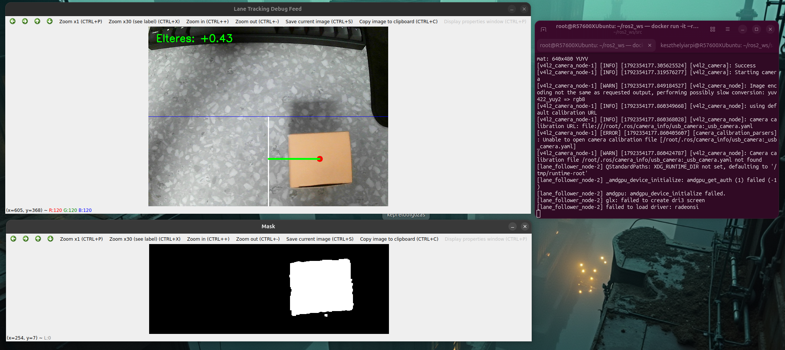
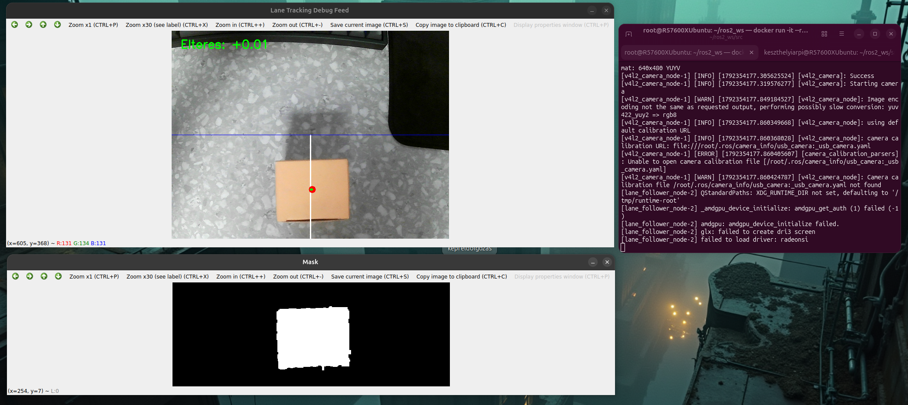
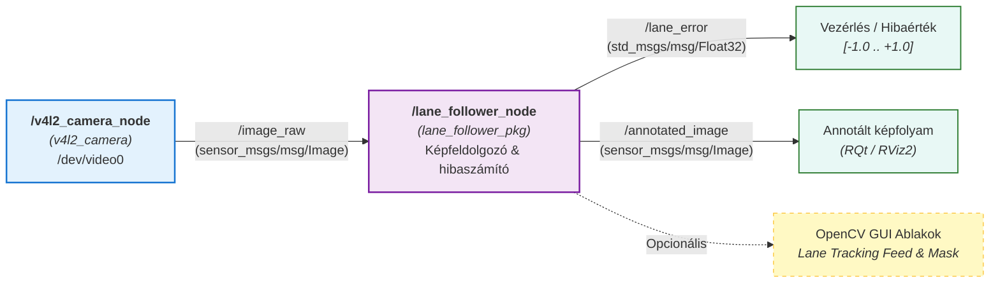

# kes_i4k_kepfeldolgozas - Sávkövető ROS 2 csomag

A projekt a Széchenyi István Egyetem **Autonóm járművek és robotok programozása** c. tantárgy kis beadandójának megvalósítása.  
A csomag egy OpenCV alapú sávfelismerő rendszert valósít meg kamerás bemenettel, amely a felismert sávhoz/irányvonalhoz képest normalizált hibajelet számít és publikál a járművezérlés számára.

---

## Működési leírás

A rendszer a `/image_raw` topicból érkező kamera képfolyamot dolgozza fel valós időben:
1. **Képfogadás**: A launch fájl automatikusan elindítja a `v4l2_camera` node-ot a fizikai webkamerához (`/dev/video0`), vagy használható bármilyen egyéb képforrás (pl. szimuláció, rosbag, usb_cam).
2. **ROI (Region of Interest) kivágása**: Az útfelületre koncentrálva a kép alsó 50%-át elemzi, elkerülve a felesleges háttérzajokat.
3. **HSV színszűrés**: Beállítható alsó és felső HSV határértékek mentén elkülöníti a sávjelzést vagy referenciaobjektumot.
4. **Centroid és eltérés-számítás**: Képmomentumok (`m00`, `m10`, `m01`) segítségével meghatározza a felismert alakzat középpontját, majd a képernyő (jármű) középvonalától mért horizontális eltérést normalizálva ($-1.0$ és $+1.0$ közötti tartományban) publikálja a `/lane_error` topicra (negatív érték: balra térés, pozitív érték: jobbra térés).
5. **Vizuális visszajelzés**: Annotált debug képet állít elő (`/annotated_image`), valamint ha a GUI engedélyezve van, OpenCV ablakokban közvetlenül megjeleníti a kameraképet a középvonallal, detektált ponttal és hibaértékkel.

---

## Működés közben (Képernyőképek)

A csomag sikeresen tesztelve lett valós USB kamerával és Docker környezetben indított ROS 2 rendszerrel:

| 1. Eltérés észlelése jobbra (`Elteres: +0.43`) |
|:---:|
|  |

| 2. Középre rendezett állapot (`Elteres: +0.01`) |
|:---:|
|  |

---

## Node-ok, Topic-ok és Rendszerarchitektúra

A rendszer felépítését és az adatáramlást az alábbi Mermaid diagram szemlélteti:



### Node és interfész táblázat

| Komponens | Név / Topic | Típus | Szerep | Leírás |
|---|---|---|---|---|
| **Node** | `/v4l2_camera_node` | `v4l2_camera` | Producer | Linux V4L2 USB kamera driver és képfolyam kezelő |
| **Node** | `/lane_follower_node` | `lane_follower_pkg` | Feldolgozó | OpenCV képfeldolgozó, centroid- és hibaszámító csomópont |
| **Topic** | `/image_raw` | `sensor_msgs/msg/Image` | Feliratkozás | Nyers kamera képfolyam (640x480 YUYV / RGB) |
| **Topic** | `/lane_error` | `std_msgs/msg/Float32` | Publikálás | Sávközéptől mért normalizált hiba (-1.0: balra, +1.0: jobbra) |
| **Topic** | `/annotated_image` | `sensor_msgs/msg/Image` | Publikálás | Annotált debug kép a sáv-, centroid- és eltérésjelölésekkel |

### Főbb paraméterek

- `show_gui` (`bool`, alapértelmezett: `True`): OpenCV grafikus ablakok megjelenítése (`Lane Tracking Debug Feed` és `Mask`).
- `lower_hsv` (`int[]`, alapértelmezett: `[13, 55, 70]`): Alsó HSV színszűrési határérték.
- `upper_hsv` (`int[]`, alapértelmezett: `[30, 255, 255]`): Felső HSV színszűrési határérték.

---

## Futtatás és Telepítés

A projekt futtatható közvetlenül natív Linux rendszeren, illetve Docker konténerben is.

### Indítás Docker konténerben (Tesztelt környezet Linux gazdagépen)

A fejlesztés és tesztelés az alábbi módon történt Ubuntu gazdagépen az `osrf/ros:jazzy-desktop` hivatalos konténer használatával:

#### 1. Grafikus ablakok (X11) engedélyezése a gazdagépen
```bash
xhost +local:docker
```

#### 2. Docker konténer indítása kamera és GUI becsatolással
```bash
docker run -it --rm \
  --name ros2_dev \
  --net=host \
  --env="DISPLAY=$DISPLAY" \
  --volume="/tmp/.X11-unix:/tmp/.X11-unix:rw" \
  --volume="$HOME/ros2_ws:/root/ros2_ws" \
  --device=/dev/video0:/dev/video0 \
  osrf/ros:jazzy-desktop \
  bash
```

#### 3. Csomagok építése és indítás a konténeren belül
```bash
# Belépés a workspace-be
cd /root/ros2_ws

# Kameracsomag telepítése
apt-get update && apt-get install -y ros-jazzy-v4l2-camera

# Csomag lefordítása
colcon build --packages-select lane_follower_pkg --symlink-install

# Környezet betöltése
source install/setup.bash

# Indítás az egységesített launch fájllal
ros2 launch lane_follower_pkg lane_follower.launch.py
```

---

## Tesztelés és Monitorozás

Egy új terminálban ellenőrizhetők a node által előállított kimenetek:

### 1. Kiszámított hibaérték valós idejű figyelése
```bash
ros2 topic echo /lane_error
```

### 2. Annotált kép megtekintése RQt-val
```bash
ros2 run rqt_image_view rqt_image_view /annotated_image
```

### 3. Önálló HSV kalibrációs segédprogram
A sáv vagy követendő objektum színének beállításához a csomag tartalmaz egy interaktív tesztprogramot élő csúszkákkal:
```bash
python3 lane_follower_pkg/lane_detector.py
```
*(A beállított alsó és felső HSV értékek a terminálban kiírásra kerülnek, amelyek átmásolhatók a node paramétereibe).*

---

## Szerző és Licenc

- **Szerző**: Keszthelyi Árpád (Neptun: I4KEBG)
- **Tantárgy**: Autonóm járművek és robotok programozása (Széchenyi István Egyetem)
- **Licenc**: GNU General Public License v3.0 ([LICENSE](LICENSE))